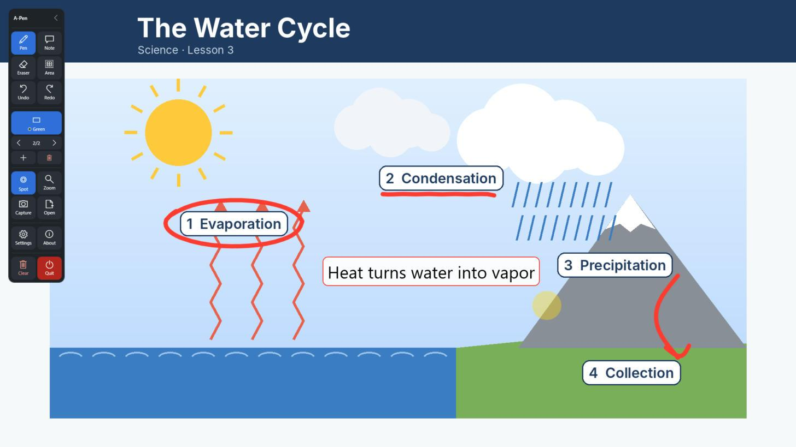
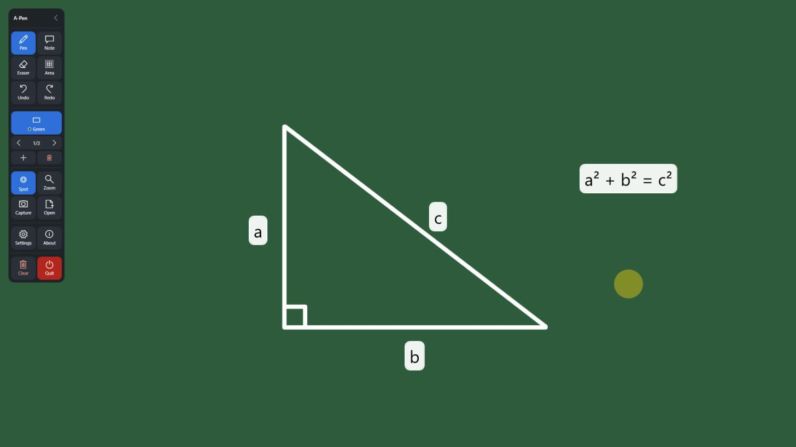
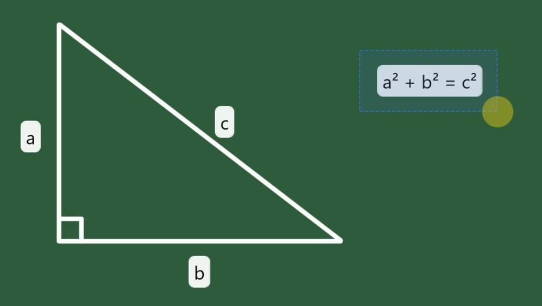
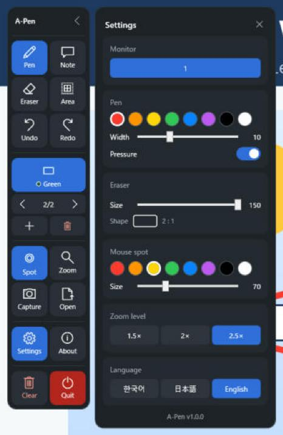
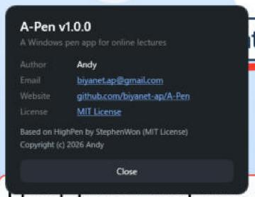

# A-Pen

[English](README.md) | **한국어** | [日本語](README.ja.md)

비대면 강의와 교실 수업을 위한 Windows 펜 앱입니다. 발표 화면 위에 바로 쓰고, 칠판으로 바꿔 판서하고, 판서를 저장해 두었다가 다음 수업에서 다시 불러올 수 있습니다. 와콤 같은 펜 태블릿, 마우스, 전자칠판에서 쓸 수 있습니다.

버전 1.0.0 · Windows 10/11 · [MIT License](LICENSE) · [HighPen](https://github.com/stepanowon/high-pen) 기반



## 설치

1. [최신 릴리스](https://github.com/biyanet-ap/A-Pen/releases/latest)에서 **[A-Pen-Setup.exe](https://github.com/biyanet-ap/A-Pen/releases/latest/download/A-Pen-Setup.exe)** 를 받습니다.
2. 실행합니다. **"Windows의 PC 보호"** 경고가 뜨면 **추가 정보 → 실행**을 누릅니다. (파일에 코드 서명이 없어서 뜨는 경고입니다.)
3. 세 가지 질문에 답합니다. 설치할지, 바탕화면 바로가기를 만들지, 지금 실행할지입니다.

A-Pen은 `%LOCALAPPDATA%\Programs\A-Pen`에 설치되고 시작 메뉴에 등록됩니다. 관리자 권한은 필요 없습니다.

- **설치 없이 쓰기:** [A-Pen.exe](https://github.com/biyanet-ap/A-Pen/releases/latest/download/A-Pen.exe)를 받아 바로 실행합니다.
- **업데이트:** 새 설치 파일을 실행하면 덮어씁니다.
- **제거:** 설정 → 앱 → **설치된 앱** → A-Pen → 제거. 설정은 `%APPDATA%\A-Pen`에 남으니, 완전히 지우려면 이 폴더도 지웁니다.
- **묻지 않고 설치:** `A-Pen-Setup.exe /S`
- **스마트 앱 컨트롤:** Windows 11의 스마트 앱 컨트롤이 켜져 있으면 서명 없는 파일은 "실행" 선택지 없이 막힙니다. A-Pen을 쓰려면 스마트 앱 컨트롤을 꺼야 합니다(Windows 보안 → 앱 및 브라우저 컨트롤). 2026년 4월 Windows 업데이트(KB5083769)가 없으면 한 번 끈 뒤 다시 켤 수 없으니 먼저 Windows를 업데이트하세요.

툴바는 화면 왼쪽 위에 영어로 나타납니다. **Settings**를 누르고 **Language**에서 **한국어**를 고르면 바로 바뀝니다.

## 기능

| 기능 | 하는 일 |
|---|---|
| **펜** (Pen) | 화면 위 어디에나 씁니다. 펜을 끄면 필기는 남은 채로 발표 자료를 넘길 수 있습니다. 8가지 색, 두께 1~30, 필압 반영. |
| **칠판** (Board) | 화면을 칠판으로 덮습니다. **녹색 → 흰색 → 검정 → 끄기** 순서로 바뀝니다. 칠판마다 페이지를 따로 가집니다(`◀ 2/5 ▶`, **+** 새 페이지, 휴지통 삭제). 칠판 색에 묻히는 펜 색은 자동으로 바뀝니다. |
| **지우개** (Eraser) | 칠판 지우개처럼 문지른 부분만 지웁니다. 크기 10~150. |
| **영역** (Area) | 드래그한 사각형 안을 한 번에 지웁니다. |
| **지우기** (Clear) | 지금 페이지를 모두 지웁니다. |
| **되돌리기 / 다시 실행** (Undo / Redo) | 한 단계씩 취소하거나 다시 적용합니다. 페이지마다 따로 동작합니다. |
| **말풍선** (Note) | 입력한 글자를 상자에 넣어 붙입니다. |
| **캡처** (Capture) | 작동 모니터 화면을 바탕화면에 PNG로 저장합니다. 툴바와 마우스 스팟은 찍히지 않습니다. |
| **불러오기** (Open) | 이미지를 칠판 새 페이지로 불러와 이어서 씁니다. |
| **확대** (Zoom) | 포인터 주변을 1.5배·2배·2.5배로 확대합니다. 확대한 채로 쓸 수 있습니다. |
| **스팟** (Spot) | 포인터를 따라다니는 반투명 원으로, 시청자가 포인터를 쉽게 찾게 해 줍니다. |
| **모니터** (Monitor) | 모니터가 2대 이상이면 툴바에서 A-Pen이 동작할 모니터를 고릅니다. |

설정(펜, 지우개, 스팟, 확대 배율, 모니터, 언어)은 바꾸는 즉시 `%APPDATA%\A-Pen\settings.txt`에 저장됩니다.

<p>


</p>

왼쪽: 녹색 칠판의 한 페이지(2장 중 1). 오른쪽: 영역 지우기. 드래그한 사각형 안이 모두 지워집니다.

### 툴바와 설정



> 필기와 칠판 페이지는 A-Pen을 끄면 사라집니다. 남겨 둘 판서는 캡처해 두었다가 **불러오기**로 다시 여세요.

## 전자칠판에서 쓰기

1. 전자칠판의 **터치용으로 짝지어진 HDMI 포트**와 **USB 터치 포트**를 함께 연결합니다. HDMI만 연결하면 화면은 나오지만 터치가 되지 않습니다.
2. Windows 설정 → 시스템 → 정보의 "펜 및 터치"에 터치 포인트가 표시되는지 확인합니다.
3. 칠판을 눌렀는데 노트북 화면이 반응하면 `tabletpc.cpl` → **디스플레이** 탭 → **설정** → **터치 입력**을 고르고, 안내가 나오면 칠판을 터치합니다.
4. A-Pen 툴바의 모니터 줄에서 칠판 화면 번호를 고릅니다.

## 직접 빌드하기

Visual Studio나 .NET SDK가 필요 없습니다. Windows에 들어 있는 C# 컴파일러로 빌드합니다.

```powershell
.\build.ps1    # dist\A-Pen.exe 와 dist\A-Pen-Setup.exe 를 만듭니다
```

## 원본 HighPen

A-Pen은 StephenWon이 MIT License로 공개한 **[HighPen](https://github.com/stepanowon/high-pen)** 을 바탕으로 만들었습니다. 원작자께 감사드립니다.



**A-Pen에서 더한 것**

- 녹색 칠판, 칠판마다 여러 페이지
- 문지른 부분만 지우는 지우개(크기 조절), 영역 지우기
- 다시 실행
- 화면 캡처 저장, 캡처를 칠판 페이지로 불러오기
- 툴바에서 모니터 고르기
- 새 툴바 디자인과 앱 아이콘

**HighPen과 다른 점**

- 이름, 설치 폴더, 설정 폴더가 달라서 HighPen과 함께 설치하고 동시에 실행할 수 있습니다.
- winget과 Microsoft Store의 HighPen은 원본이라 위 기능이 없습니다.
- 원작의 저작권 표시는 [LICENSE](LICENSE)에 그대로 있습니다.

## 개인정보

A-Pen은 네트워크에 연결하지 않으며, 어떤 정보도 수집하거나 보내지 않습니다. 필기는 캡처할 때만 저장됩니다. 자세한 내용은 [개인정보 처리방침](PRIVACY.md#한국어)을 보세요.

## 라이선스

[MIT License](LICENSE). Copyright (c) 2026 StephenWon (HighPen), Copyright (c) 2026 Andy (A-Pen에서 바꾼 부분).
